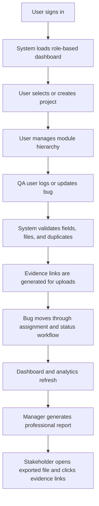

## 1. Product Overview
The Bug Tracking & Test Reporting Web Application helps QA teams and reporting managers manage project structures, log defects with evidence, and generate executive-ready reports from a single workspace.
- It solves fragmented QA workflows by unifying project hierarchy management, defect tracking, analytics, and multi-format reporting.
- It targets internal QA teams, reporting managers, and stakeholders who need fast visibility into testing quality, delivery risk, and team productivity.

## 2. Core Features

### 2.1 User Roles
| Role | Registration Method | Core Permissions |
|------|---------------------|------------------|
| Reporting Manager | Admin-created account or secure sign-in | View all projects and bugs, supervise QA activity, manage projects/modules, review analytics, export reports, optionally manage user access |
| QA User | Admin-created account or secure sign-in | Create and manage accessible projects/modules, report and update bugs, upload evidence, generate project reports |

### 2.2 Feature Module
1. **Authentication & Access**: secure sign-in, role-aware navigation, protected routes, session management.
2. **Dashboard**: summary widgets, bug status overview, project distribution, trend insights, QA productivity metrics.
3. **Projects & Module Hierarchy**: create projects, manage nested modules and sub-modules, dynamic hierarchy expansion.
4. **Bug Management**: create, edit, assign, filter, search, track, and comment on defect records with evidence attachments.
5. **Media Library**: upload screenshots and videos, preview media, generate shareable links, one-click link copy.
6. **Reports & Analytics**: generate corporate-style reports with summaries, charts, evidence links, and export to PDF, DOCX, and XLSX.
7. **Administration**: manage users, permissions, audit visibility, and configuration settings when enabled.

### 2.3 Page Details
| Page Name | Module Name | Feature description |
|-----------|-------------|---------------------|
| Sign In | Authentication | Email/password sign-in, validation, role resolution, session start, password visibility toggle |
| Dashboard | Executive overview | KPI widgets for total, open, closed, in-progress, and critical bugs; recent activity; priority alerts |
| Dashboard | Visual analytics | Pie, bar, and trend charts for type, status, severity, project distribution, and monthly testing progress |
| Projects | Project registry | Create, edit, archive, and search projects with owner, status, and release metadata |
| Project Detail | Module hierarchy manager | Add modules, sub-modules, and deeper nested levels dynamically through a tree or indented structure |
| Bug List | Defect operations | Table and board views, advanced filters, quick actions, duplicate detection hints, assignment workflow, read-only supervision for reporting managers |
| Bug Detail | Bug record | Full bug form with title, description, severity, priority, environment, steps, expected result, actual result, reporter, assignee, status, timestamps for QA users; reporting managers only review and supervise |
| Bug Detail | Evidence manager | Multi-image upload, video upload, inline preview, secure link generation, copy-link action, file validation |
| Reports | Report builder | Select project and time period, configure sections, preview charts, generate branded reports |
| Reports | Export center | Export report packages to PDF, DOCX, XLSX with screenshot hyperlinks instead of embedded images |
| Analytics | Performance view | Tester productivity, execution statistics, bug trends, severity impact, module risk heatmap |
| User Management | Access control | Create users, assign roles, control project access, review account status and audit-relevant actions |
| Audit Log | Critical activity tracking | View important events such as project creation, role changes, bug status changes, and report exports |

## 3. Core Process
The main workflow starts when a user signs in and lands on a role-aware dashboard. A QA user creates or selects a project, manages the module hierarchy, logs a bug with structured details and evidence, then tracks its lifecycle until closure. A reporting manager monitors all projects, supervises QA activity through the bug workspace, reviews analytics, and generates executive reports for stakeholders, but does not create bug records. Media attachments remain secure and are shared through generated URLs so reports can reference evidence through clickable links instead of embedded files.

## 4. User Interface Design
### 4.1 Design Style
- Primary colors: deep slate, graphite, and midnight blue with teal and amber accents for status emphasis.
- Button style: softly rounded rectangular buttons with subtle elevation, strong hover states, and icon pairing for key actions.
- Font and sizes: distinctive display font for page headers paired with a highly readable sans-serif for dense QA data views.
- Layout style: desktop-first application shell with left-side navigation, top utility bar, analytic cards, and modular content panels.
- Icon style suggestions: polished line icons with selective filled status icons for bug types, severity, and workflow states.
- Visual direction: premium enterprise console with dark-rich surfaces, clean spacing, restrained gradients, and high-information density.

### 4.2 Page Design Overview
| Page Name | Module Name | UI Elements |
|-----------|-------------|-------------|
| Dashboard | KPI header | Large metrics, accent status pills, animated counters, gradient highlights |
| Dashboard | Charts area | Highcharts panels, legend cards, hover tooltips, drill-down affordances |
| Projects | Project table | Search bar, filter chips, status badges, quick-create drawer |
| Project Detail | Hierarchy tree | Expandable nested nodes, inline add controls, context menu, breadcrumb trail |
| Bug List | Defect board/table | Toggleable view modes, severity color coding, sticky filters, bulk actions |
| Bug Detail | Evidence section | Drag-and-drop uploader, media thumbnails, preview modal, copy-link action |
| Reports | Builder workspace | Section selector, export format cards, chart preview panes, executive summary editor |
| User Management | User grid | Role tags, access matrix, invite action, status indicators |

### 4.3 Responsiveness
- Desktop-first experience with full analytics, dense tables, and hierarchy editing optimized for larger screens.
- Tablet layout collapses secondary panels into drawers while preserving reporting and bug update workflows.
- Mobile layout prioritizes dashboard summaries, bug creation, evidence viewing, and approval/review actions with touch-friendly controls.

### 4.4 Accessibility and UX Notes
- Maintain WCAG-aware contrast for severity colors, status badges, and chart palettes.
- Provide keyboard access for filters, tree navigation, dialogs, and upload actions.
- Use clear validation copy, inline helper text, and persistent save feedback for complex QA forms.
- Support optional light and dark themes without compromising data legibility.
