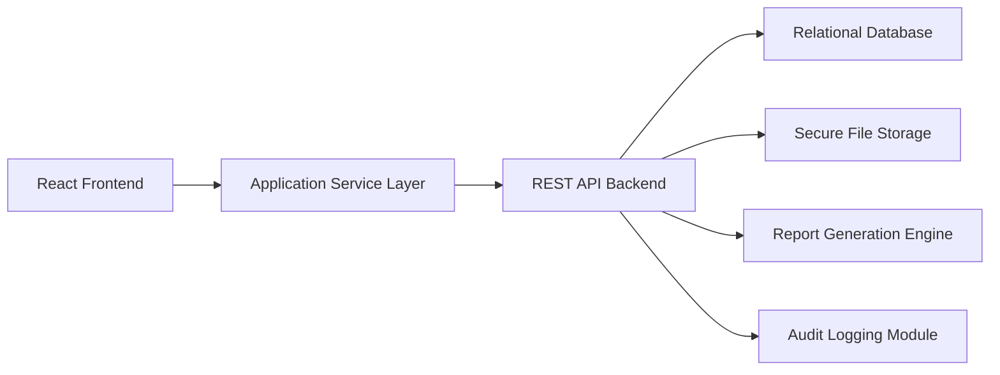
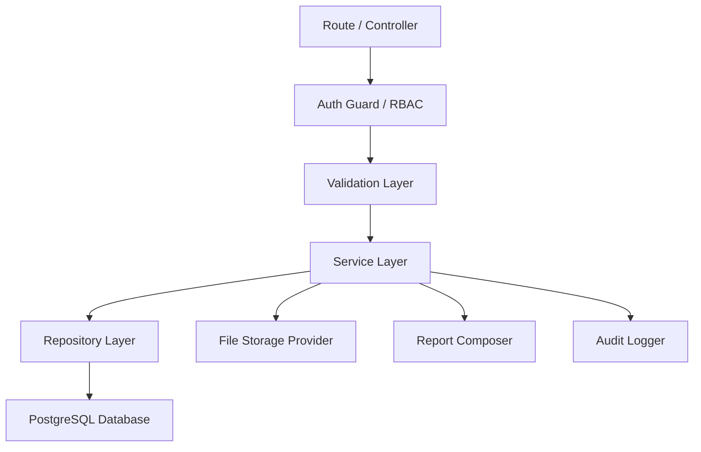
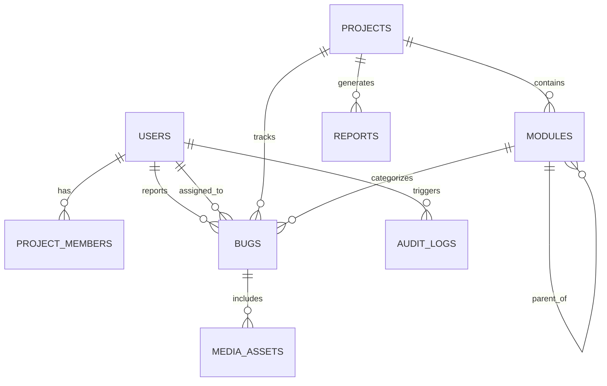

## 1. Architecture Design


## 2. Technology Description
- Frontend: React 18 + TypeScript + Vite + Tailwind CSS + React Router + TanStack Query
- State and forms: React Hook Form + Zod + lightweight local UI state store
- Data visualization: Highcharts with responsive chart wrappers
- Backend: Node.js + NestJS or Express with modular service architecture and TypeScript
- Database: PostgreSQL for relational data, indexing, filtering, and reporting queries
- File storage: protected object storage abstraction for screenshots and videos with signed or controlled public URLs
- Report generation: PDF renderer, DOCX generator, XLSX export utilities, shared report composition service
- Authentication: JWT or secure session-based auth with role-based access control middleware
- Initialization Tool: Vite for frontend bootstrap, backend initialized as a separate TypeScript service

## 3. Route Definitions
| Route | Purpose |
|-------|---------|
| /signin | User authentication entry point |
| /dashboard | Role-aware summary metrics and analytics |
| /projects | Project listing, creation, and search |
| /projects/:projectId | Project overview and editable project details |
| /projects/:projectId/modules | Nested module and sub-module management |
| /bugs | Global or scoped bug management workspace with QA create access and manager supervision-only access |
| /bugs/new | Create a new bug with evidence uploads for QA users only |
| /bugs/:bugId | View and update bug details, status, and attachments |
| /reports | Report builder, preview, and export actions |
| /analytics | Advanced charts and productivity insights |
| /users | User and permission management for authorized roles |
| /audit-log | Critical action history and compliance visibility |

## 4. API Definitions
```ts
type UserRole = "REPORTING_MANAGER" | "QA_USER";

type BugType =
  | "FUNCTIONAL"
  | "SECURITY"
  | "UI_UX"
  | "RESPONSIVE"
  | "PERFORMANCE"
  | "COMPATIBILITY"
  | "ACCESSIBILITY"
  | "INTEGRATION"
  | "DATA_VALIDATION"
  | "OTHER";

type BugStatus = "OPEN" | "IN_PROGRESS" | "RESOLVED" | "CLOSED" | "REOPENED";
type Severity = "LOW" | "MEDIUM" | "HIGH" | "CRITICAL";
type Priority = "LOW" | "MEDIUM" | "HIGH" | "URGENT";

interface ProjectDto {
  id: string;
  name: string;
  code: string;
  description?: string;
  ownerId: string;
  status: "ACTIVE" | "ON_HOLD" | "ARCHIVED";
  createdAt: string;
  updatedAt: string;
}

interface ModuleNodeDto {
  id: string;
  projectId: string;
  parentId: string | null;
  name: string;
  level: number;
  path: string;
  sortOrder: number;
}

interface BugDto {
  id: string;
  title: string;
  description: string;
  projectId: string;
  moduleId: string;
  type: BugType;
  severity: Severity;
  priority: Priority;
  environment: string;
  stepsToReproduce: string;
  expectedResult: string;
  actualResult: string;
  reporterId: string;
  assignedUserId?: string;
  status: BugStatus;
  createdAt: string;
  updatedAt: string;
}

interface MediaAssetDto {
  id: string;
  bugId: string;
  kind: "SCREENSHOT" | "VIDEO";
  fileName: string;
  mimeType: string;
  fileSize: number;
  storageKey: string;
  shareUrl: string;
  createdAt: string;
}

interface ReportRequestDto {
  projectId: string;
  fromDate: string;
  toDate: string;
  formats: Array<"PDF" | "DOCX" | "XLSX">;
  includeExecutiveSummary: boolean;
  includeEvidenceLinks: boolean;
}

interface DashboardMetricsDto {
  totalBugs: number;
  openBugs: number;
  closedBugs: number;
  inProgressBugs: number;
  criticalBugs: number;
}
```

### Suggested Endpoints
| Method | Endpoint | Purpose |
|--------|----------|---------|
| POST | /api/auth/signin | Authenticate user and return session token |
| GET | /api/dashboard/metrics | Load summary widgets and top-level counts |
| GET | /api/dashboard/charts | Load chart data by type, status, severity, project, and month |
| GET | /api/projects | List accessible projects |
| POST | /api/projects | Create project |
| PATCH | /api/projects/:projectId | Update project |
| GET | /api/projects/:projectId/modules | Get nested module tree |
| POST | /api/projects/:projectId/modules | Create module or sub-module |
| PATCH | /api/modules/:moduleId | Update hierarchy node |
| GET | /api/bugs | Query bugs with filters, search, and pagination |
| POST | /api/bugs/duplicate-check | Detect likely duplicate bugs before save |
| POST | /api/bugs | Create bug for QA users only |
| GET | /api/bugs/:bugId | Fetch bug details |
| PATCH | /api/bugs/:bugId | Update bug fields and status |
| POST | /api/bugs/:bugId/media | Upload screenshots or videos |
| GET | /api/media/:assetId/share | Resolve secure share URL |
| POST | /api/reports/generate | Generate report files in selected formats |
| GET | /api/reports/:reportId | Fetch report metadata and download links |
| GET | /api/users | List users and permissions for administrators |
| GET | /api/audit-log | Query security and workflow audit events |

## 5. Server Architecture Diagram


## 6. Data Model
### 6.1 Data Model Definition


### 6.2 Data Definition Language
```sql
CREATE TABLE users (
  id UUID PRIMARY KEY,
  full_name VARCHAR(120) NOT NULL,
  email VARCHAR(180) UNIQUE NOT NULL,
  password_hash TEXT NOT NULL,
  role VARCHAR(30) NOT NULL CHECK (role IN ('REPORTING_MANAGER', 'QA_USER')),
  is_active BOOLEAN NOT NULL DEFAULT TRUE,
  created_at TIMESTAMP NOT NULL DEFAULT NOW(),
  updated_at TIMESTAMP NOT NULL DEFAULT NOW()
);

CREATE TABLE projects (
  id UUID PRIMARY KEY,
  name VARCHAR(150) NOT NULL,
  code VARCHAR(40) UNIQUE NOT NULL,
  description TEXT,
  owner_id UUID NOT NULL REFERENCES users(id),
  status VARCHAR(20) NOT NULL DEFAULT 'ACTIVE',
  created_at TIMESTAMP NOT NULL DEFAULT NOW(),
  updated_at TIMESTAMP NOT NULL DEFAULT NOW()
);

CREATE TABLE project_members (
  project_id UUID NOT NULL REFERENCES projects(id) ON DELETE CASCADE,
  user_id UUID NOT NULL REFERENCES users(id) ON DELETE CASCADE,
  access_level VARCHAR(30) NOT NULL DEFAULT 'CONTRIBUTOR',
  PRIMARY KEY (project_id, user_id)
);

CREATE TABLE modules (
  id UUID PRIMARY KEY,
  project_id UUID NOT NULL REFERENCES projects(id) ON DELETE CASCADE,
  parent_id UUID REFERENCES modules(id) ON DELETE CASCADE,
  name VARCHAR(160) NOT NULL,
  level INT NOT NULL,
  path TEXT NOT NULL,
  sort_order INT NOT NULL DEFAULT 0,
  created_at TIMESTAMP NOT NULL DEFAULT NOW(),
  updated_at TIMESTAMP NOT NULL DEFAULT NOW()
);

CREATE TABLE bugs (
  id UUID PRIMARY KEY,
  project_id UUID NOT NULL REFERENCES projects(id) ON DELETE CASCADE,
  module_id UUID NOT NULL REFERENCES modules(id),
  title VARCHAR(220) NOT NULL,
  description TEXT NOT NULL,
  bug_type VARCHAR(40) NOT NULL,
  severity VARCHAR(20) NOT NULL,
  priority VARCHAR(20) NOT NULL,
  environment VARCHAR(120) NOT NULL,
  steps_to_reproduce TEXT NOT NULL,
  expected_result TEXT NOT NULL,
  actual_result TEXT NOT NULL,
  reporter_id UUID NOT NULL REFERENCES users(id),
  assigned_user_id UUID REFERENCES users(id),
  status VARCHAR(20) NOT NULL DEFAULT 'OPEN',
  duplicate_hash VARCHAR(120),
  created_at TIMESTAMP NOT NULL DEFAULT NOW(),
  updated_at TIMESTAMP NOT NULL DEFAULT NOW()
);

CREATE INDEX idx_bugs_project_status ON bugs(project_id, status);
CREATE INDEX idx_bugs_severity_priority ON bugs(severity, priority);
CREATE INDEX idx_modules_project_parent ON modules(project_id, parent_id);

CREATE TABLE media_assets (
  id UUID PRIMARY KEY,
  bug_id UUID NOT NULL REFERENCES bugs(id) ON DELETE CASCADE,
  kind VARCHAR(20) NOT NULL CHECK (kind IN ('SCREENSHOT', 'VIDEO')),
  file_name VARCHAR(255) NOT NULL,
  mime_type VARCHAR(120) NOT NULL,
  file_size BIGINT NOT NULL,
  storage_key TEXT NOT NULL,
  share_url TEXT NOT NULL,
  created_at TIMESTAMP NOT NULL DEFAULT NOW()
);

CREATE TABLE reports (
  id UUID PRIMARY KEY,
  project_id UUID NOT NULL REFERENCES projects(id) ON DELETE CASCADE,
  requested_by UUID NOT NULL REFERENCES users(id),
  formats TEXT NOT NULL,
  from_date DATE NOT NULL,
  to_date DATE NOT NULL,
  output_manifest JSONB NOT NULL,
  created_at TIMESTAMP NOT NULL DEFAULT NOW()
);

CREATE TABLE audit_logs (
  id UUID PRIMARY KEY,
  actor_id UUID REFERENCES users(id),
  action VARCHAR(120) NOT NULL,
  entity_type VARCHAR(80) NOT NULL,
  entity_id UUID,
  metadata JSONB NOT NULL DEFAULT '{}'::jsonb,
  created_at TIMESTAMP NOT NULL DEFAULT NOW()
);
```

## 7. Validation and Security Notes
- Enforce server-side and client-side validation for required fields, file type, file size, URL formats, and string length boundaries.
- Implement duplicate bug detection using normalized title, project, module path, and environment fingerprints before persistence.
- Protect file uploads through MIME verification, extension validation, storage isolation, and access-controlled share URLs.
- Apply RBAC at route, API, and record levels so reporting managers see all data in supervision mode while QA users see authorized scopes and are the only role allowed to create bug records.
- Log sensitive actions such as role changes, report exports, project updates, and bug status transitions.

## 8. Performance and Scalability Notes
- Use paginated bug queries, indexed filtering, and server-side aggregations for dashboard metrics.
- Cache chart datasets and report-ready aggregates where practical to reduce repeated computation.
- Store media metadata separately from binary assets to keep transactional queries fast.
- Keep the frontend modular with lazy-loaded analytics and reporting sections to improve initial load time.
